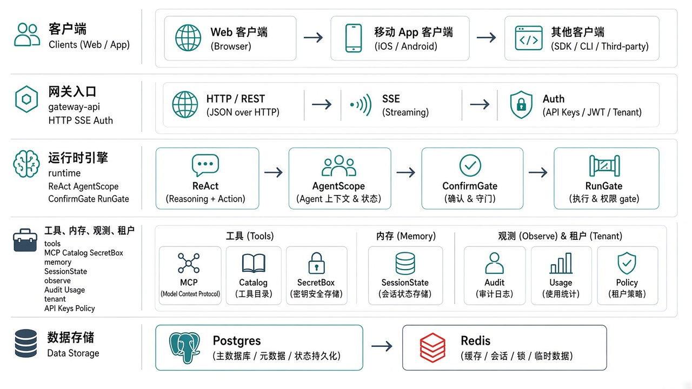

<p align="center">
  
</p>

<h1 align="center">Agent Gateway</h1>

<p align="center">
  多租户 <b>ReAct Agent 网关</b>（Java）· MCP 优先 · 不做 RAG
</p>

<p align="center">
  包名 <code>com.agent.gateway</code> · Maven <code>groupId: com.agent</code>
</p>

---

## 项目定位

对外提供可部署的 Agent 服务：租户用 API Key 鉴权后，通过 **HTTP/SSE** 发起多轮对话；模型在 **ReAct** 循环里决定是否调用该租户注册的 **MCP** 工具；写操作可走人工确认；全程按 `tenant_id` 逻辑隔离，并记录审计与用量。

与「知识库问答平台」不同：**本项目不做文档解析、向量检索、意图树 RAG**。需要检索时，由租户自行挂 MCP 工具提供。

设计文档：[docs/specs/2026-11-05-react-agent-gateway-design.md](docs/specs/2026-11-05-react-agent-gateway-design.md)

---

## 快速启动

### 前置

- JDK 17+
- Maven 3.9+
- Docker（用于 Postgres / Redis）

### 1. 起基础设施

```bash
cd /path/to/agent-gateway
docker compose up -d
# 起 Postgres(5432) + Redis(6379)；MVP 默认 RunGate 为内存，Redis 可选
```

### 2. 环境变量

```bash
export GATEWAY_SECRET_MASTER_KEY=0123456789abcdef   # MCP Header 加密主密钥（≥16 字节）
export GATEWAY_ADMIN_API_KEY=sk_admin_local_dev     # 可选：启动种子 ADMIN Key
# 真实模型（可选）：
# export GATEWAY_AGENT_MODE=agentscope
# export GATEWAY_LLM_API_KEY=sk-...
# export GATEWAY_LLM_BASE_URL=https://api.openai.com
# export GATEWAY_LLM_MODEL=gpt-4o-mini
# 多实例并发闸（可选）：
# export GATEWAY_RUN_GATE_TYPE=redis
# export GATEWAY_REDIS_ADDRESS=redis://127.0.0.1:6379
```

### 3. 启动

```bash
mvn -pl bootstrap -am spring-boot:run
# 默认 http://localhost:8080
```

### 4. 最小联调（echo 模式）

```bash
# 用种子 ADMIN Key 创建业务租户并签发 RUNTIME Key
curl -s -X POST http://localhost:8080/admin/tenants \
  -H "Authorization: Bearer sk_admin_local_dev" \
  -H "Content-Type: application/json" \
  -d '{"name":"demo","modelTier":"standard","maxConcurrent":5}'

# 将返回的 tenantId 代入签发 Key（示例）
curl -s -X POST http://localhost:8080/admin/tenants/<tenantId>/api-keys \
  -H "Authorization: Bearer sk_admin_local_dev" \
  -H "Content-Type: application/json" \
  -d '{"role":"RUNTIME"}'

# SSE 对话（把 apiKey 换成上一步返回的明文）
curl -N -X POST http://localhost:8080/v1/chat \
  -H "Authorization: Bearer <apiKey>" \
  -H "Content-Type: application/json" \
  -d '{"message":"hello"}'
```

### 5. 验证测试

```bash
mvn test
```

---

## 项目架构

<p align="center">
  
</p>

### 逻辑分层

| 层 | 模块 | 职责 |
|---|---|---|
| 接入层 | `gateway-api` | API Key 鉴权、管理面/数据面 HTTP、异步 SSE |
| 运行时 | `runtime` | ReAct 编排、ConfirmGate、RunGate、事件映射 |
| 领域支撑 | `tenant` / `tools` / `memory` / `observe` | 身份策略、MCP 目录、会话状态、审计用量 |
| 启动装配 | `bootstrap` | Spring Boot 入口、Schema 初始化、ADMIN 种子 |
| 基础设施 | Postgres / Redis(可选) | 持久化；多实例并发闸 |

依赖方向（禁止反向依赖）：

```text
bootstrap → gateway-api → runtime → (tools | memory | observe | tenant)
tools / memory / observe → tenant
```

### 主链路（一次对话）

```text
Client
  → ApiKeyAuthFilter（绑定 TenantContext）
  → RunGate.tryAcquire
  → TenantToolCatalog.resolve（策略 + MCP 发现）
  → AgentExecutor（echo | agentscope）边跑边推 SSE
  → 若需确认：ConfirmGate.suspend → event:confirm
  → approve/deny → resumeConfirm（METADATA_CONFIRM_RESULTS）
  → SessionStateStore + Audit/Usage
  → RunGate.release
```

---

## 技术选型

| 类别 | 选型 | 说明 |
|---|---|---|
| 语言 / 运行时 | Java 17 | 与 AgentScope / Spring Boot 3 对齐 |
| 框架 | Spring Boot 3.4.x | Web、JDBC、配置绑定 |
| Agent 引擎 | AgentScope 2.0.2 | ReActAgent、Toolkit、权限 ASK、流式事件 |
| 工具协议 | MCP Java SDK 0.17 + AgentScope MCP 客户端 | 发现/调用远端 MCP |
| 数据库 | PostgreSQL 16 | 租户、MCP、确认单、审计等；逻辑多租户 |
| 缓存 / 闸门 | Redis 7 + Redisson（可选） | 多实例 RunGate；默认内存实现 |
| 构建 | Maven 多模块 | 清晰边界，便于按模块演进 |
| 测试 | JUnit 5 + H2（MODE=PostgreSQL） | 单测/隔离 IT；后续可加 Testcontainers |

**刻意不做：** 向量库、文档解析流水线、意图树 RAG（交给租户 MCP）。

---

## 前端规划（后续）

当前仓库为 **纯后端网关**。计划中的控制台 / 对话前端建议：

| 项 | 建议 |
|---|---|
| 框架 | **React 18+ + TypeScript + Vite** |
| UI | 自有设计体系或轻量组件库（避免与网关品牌冲突的默认紫系皮肤） |
| 对话 | `EventSource` / `fetch` 流式消费 SSE（`meta` / `thinking` / `tool` / `confirm` / `answer` / `done`） |
| 确认卡 | 解析 `confirm` JSON 的 `confirmId`，调用 `/v1/confirms/{id}/approve\|deny`（同样 SSE） |
| 管理面 | 租户、API Key、MCP Server、工具策略 CRUD |
| 鉴权 | `Authorization: Bearer sk_...` 或 `X-Api-Key` |
| 部署 | 静态资源独立站点或反向代理到同域 `/`，API 走 `/v1` `/admin` |

前端仓库建议与本仓库平级新建（例如 `agent-gateway-web`），通过 OpenAPI（待补 Springdoc）契约联调。

---

## 模块说明

### `tenant` — 租户与准入

多租户 SaaS 的身份与策略根基：租户档案、API Key 签发与哈希校验、请求级 `TenantContext`、工具 `ALLOW/DENY` 与是否确认。

### `tools` — MCP 注册与工具目录

把「租户配置了哪些 MCP」变成「模型本轮能看到哪些工具」：`McpRegistry`、`SecretBox`、`TenantMcpClientPool`、`TenantToolCatalog`。

### `memory` — 会话与 Agent 状态

按 `tenant_id + conversation_id` 落盘快照，保证跨租户隔离。

### `runtime` — 执行引擎与门禁

`AgentChatService` 编排；`EchoAgentExecutor` / `AgentScopeAgentExecutor`；`ConfirmGate`；`InMemoryRunGate` / `RedisRunGate`。

### `observe` — 可观测与计量

审计事件与用量事件，写入强制带 `tenant_id`。

### `gateway-api` — HTTP / SSE

鉴权过滤器、管理面、聊天与确认 API；线程池异步边跑边推。

### `bootstrap` — 启动装配

`GatewayApplication`、Schema 初始化、ADMIN Key 种子、主配置。

---

## 主要 API

| 接口 | 说明 |
|---|---|
| `POST /admin/tenants` | 创建租户（ADMIN） |
| `POST /admin/tenants/{id}/api-keys` | 签发 API Key（明文仅一次） |
| `GET/POST /admin/tenants/{id}/mcp-servers` | 列出 / 登记 MCP |
| `POST /admin/tenants/{id}/mcp-servers/{serverId}/disable` | 停用 MCP |
| `POST /admin/tenants/{id}/tool-policies` | 工具策略 |
| `POST /v1/chat` | SSE 对话（异步边跑边推） |
| `POST /v1/runs/{taskId}/cancel` | 取消任务 |
| `POST /v1/confirms/{id}/approve\|deny` | 确认后续跑（SSE） |

鉴权：`Authorization: Bearer <sk_...>` 或 `X-Api-Key: <sk_...>`。

SSE `confirm` 事件示例：

```json
{
  "taskId": "task_xxx",
  "conversationId": "conv_xxx",
  "calls": [
    { "confirmId": "cfm_xxx", "name": "delete_order", "argsJson": "{}" }
  ]
}
```

---

## 数据模型摘要

详见 [`bootstrap/src/main/resources/db/schema.sql`](bootstrap/src/main/resources/db/schema.sql)（表/字段均有中文备注）。

| 表 | 含义 |
|---|---|
| `gw_tenant` | 租户 |
| `gw_api_key` | API Key（只存哈希） |
| `gw_mcp_server` | MCP Server（Header 密文） |
| `gw_tool_policy` | 工具策略 |
| `gw_conversation` | 会话元数据 |
| `gw_agent_state` | Agent 状态快照 |
| `gw_confirm` | 人工确认单 |
| `gw_audit_event` | 审计 |
| `gw_usage_event` | 用量 |

---

## 开发规范（强制）

Cursor Rule：[`.cursor/rules/java-comment-standards.mdc`](.cursor/rules/java-comment-standards.mdc)

- 每个类、每个方法必须有**中文** Javadoc
- 关键调用行必须写「为什么调用」的中文注释
- POM 依赖、配置项、库表字段均应有说明备注

不满足注释规范的改动，视为未完成。

---

## 配置要点

主配置：[`bootstrap/src/main/resources/application.yaml`](bootstrap/src/main/resources/application.yaml)（已逐项中文备注）。

| 环境变量 | 作用 |
|---|---|
| `GATEWAY_SECRET_MASTER_KEY` | MCP Header 加密主密钥 |
| `GATEWAY_ADMIN_API_KEY` | 启动种子 ADMIN Key |
| `GATEWAY_AGENT_MODE` | `echo` / `agentscope` |
| `GATEWAY_LLM_*` | 模型 API |
| `GATEWAY_RUN_GATE_TYPE` | `memory` / `redis` |
| `GATEWAY_REDIS_ADDRESS` | Redis 地址 |

---

## 文档与进度

- 设计：[`docs/specs/2026-11-05-react-agent-gateway-design.md`](docs/specs/2026-11-05-react-agent-gateway-design.md)
- 计划：[`docs/plans/2026-11-05-react-agent-gateway-mvp.md`](docs/plans/2026-11-05-react-agent-gateway-mvp.md)
- Logo / 架构图：[`docs/assets/`](docs/assets/)
